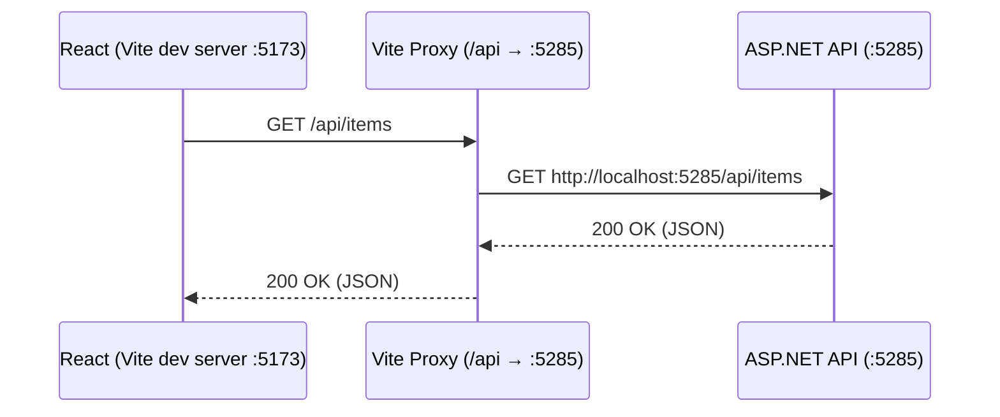

# React + TypeScript + Vite

## Local API configuration

Run `npm install`, then `npm run dev` from `frontend`. Start the backend with
its `http` launch profile as described in the [client connection guide](../backend/CarbonTracker.API/README.md#connecting-clients-in-development).
By default the Vite server at `http://localhost:5173` proxies `/api` to
`http://localhost:5285`. Copy `.env.example` to `.env.local` if you need to
configure a different API origin, for example `VITE_API_BASE_URL=http://localhost:5285`.
Use an HTTP(S) origin without a path or trailing `/api`; leave it empty for the
same-origin proxy. Restart Vite after changing it. Vite variables are embedded in
the client bundle and must never contain secrets.

Run `npm run test` for the frontend checks and `npm run build` for a production build.


To start locally
```
npm run dev
```


### Folder structure  
src/features/ → group related components + API calls

src/components/ → for shared UI bits

src/lib/ → for utilities (like API client, env config)


```
src/
  app/
    router.tsx            # routes definition
    queryClient.ts        # React Query client
    providers.tsx         # (optional) global contexts
  pages/
    HomePage.tsx          # route-level component (URL = "/")
    ItemsPage.tsx         # route-level component (URL = "/items")
  features/
    items/
      api.ts              # calls backend (/Items, mutations, etc.)
      types.ts            # Item type(s)
      hooks.ts            # useItems(), useCreateItem() etc.
      components/
        ItemsTable.tsx    # UI specific to "items" feature (used by ItemsPage)
      __tests__/...       # (optional)
  components/
    Button.tsx            # shared UI primitives (used anywhere)
    Modal.tsx
    DataTable.tsx         # generic table you can reuse across features
  lib/
    http.ts               # fetch wrapper
    env.ts                # runtime config
    format.ts             # e.g., money/date formatters
  styles/
    index.css
  App.tsx                 # app shell/layout (header/nav + <Outlet/>)
  main.tsx                # ReactDOM + providers

```


```
frontend/
├── public/                     # Static assets (copied as-is to build)
│   └── vite.svg
├── src/                        # Application source code
│   ├── app/                    # Global app setup
│   │   ├── queryClient.ts      # React Query client (API cache manager)
│   │   └── router.tsx          # React Router configuration (pages, routes)
│   │
│   ├── features/               # Feature-based modules
│   │   └── items/              # Example feature: Items
│   │       ├── ItemsPage.tsx   # React component (UI with table + button)
│   │       ├── api.ts          # API calls for Items (http.get("/Items"))
│   │       └── types.ts        # TypeScript interfaces for Item
│   │
│   ├── home/                   # Example "Home" page
│   │   └── Home.tsx
│   │
│   ├── lib/                    # Reusable utilities
│   │   ├── env.ts              # Centralized environment variables
│   │   └── http.ts             # HTTP helper (fetch wrapper)
│   │
│   ├── App.tsx                 # App layout (header + navigation)
│   ├── main.tsx                # Application entry (ReactDOM + providers)
│   ├── index.css               # Global styles
│   └── vite-env.d.ts           # Vite TypeScript types
│
├── .eslintrc.js / eslint.config.js # ESLint config (linting rules)
├── package.json                # Project dependencies + scripts
├── tsconfig.json               # TypeScript compiler config
├── vite.config.ts              # Vite build/dev config (proxy, plugins)
└── typedoc.json                # TypeDoc config for API documentation

```


## TypeDoc
Technical documentation 

`npm run docs`
Stores the html documation in subfolder typedoc, you can just open index.html

`npm run docs:open`
Runs the documentation in a local server


## StoryBooks
TO BE ADDED


# Template stuff
This template provides a minimal setup to get React working in Vite with HMR and some ESLint rules.

Currently, two official plugins are available:

- [@vitejs/plugin-react](https://github.com/vitejs/vite-plugin-react/blob/main/packages/plugin-react) uses [Babel](https://babeljs.io/) for Fast Refresh
- [@vitejs/plugin-react-swc](https://github.com/vitejs/vite-plugin-react/blob/main/packages/plugin-react-swc) uses [SWC](https://swc.rs/) for Fast Refresh

## Expanding the ESLint configuration

If you are developing a production application, we recommend updating the configuration to enable type-aware lint rules:

```js
export default tseslint.config([
  globalIgnores(['dist']),
  {
    files: ['**/*.{ts,tsx}'],
    extends: [
      // Other configs...

      // Remove tseslint.configs.recommended and replace with this
      ...tseslint.configs.recommendedTypeChecked,
      // Alternatively, use this for stricter rules
      ...tseslint.configs.strictTypeChecked,
      // Optionally, add this for stylistic rules
      ...tseslint.configs.stylisticTypeChecked,

      // Other configs...
    ],
    languageOptions: {
      parserOptions: {
        project: ['./tsconfig.node.json', './tsconfig.app.json'],
        tsconfigRootDir: import.meta.dirname,
      },
      // other options...
    },
  },
])
```

You can also install [eslint-plugin-react-x](https://github.com/Rel1cx/eslint-react/tree/main/packages/plugins/eslint-plugin-react-x) and [eslint-plugin-react-dom](https://github.com/Rel1cx/eslint-react/tree/main/packages/plugins/eslint-plugin-react-dom) for React-specific lint rules:

```js
// eslint.config.js
import reactX from 'eslint-plugin-react-x'
import reactDom from 'eslint-plugin-react-dom'

export default tseslint.config([
  globalIgnores(['dist']),
  {
    files: ['**/*.{ts,tsx}'],
    extends: [
      // Other configs...
      // Enable lint rules for React
      reactX.configs['recommended-typescript'],
      // Enable lint rules for React DOM
      reactDom.configs.recommended,
    ],
    languageOptions: {
      parserOptions: {
        project: ['./tsconfig.node.json', './tsconfig.app.json'],
        tsconfigRootDir: import.meta.dirname,
      },
      // other options...
    },
  },
])
```




## Web authentication

Register at `/register` and sign in at `/login`. Sessions are stored in the browser's
`sessionStorage`, so a reload in the same tab keeps the session; closing the tab
ends local persistence. On a protected API 401, the client exchanges the refresh
token once and retries the request. Sign-out clears local data immediately and
attempts to revoke the refresh token on the server. If revocation fails, the UI
reports it; an already issued access token remains valid until it expires.

Both tokens are readable by JavaScript in the page. An XSS attack or a malicious
extension can steal them; per-tab storage reduces persistence but does not protect
against XSS. A server-managed session using secure HttpOnly cookies would reduce
that exposure and would require backend and CSRF changes. Use HTTPS in deployment
and avoid putting secrets in frontend environment variables.

## Frontend quality checks

From `frontend`, run `npm ci`, then `npm run lint`, `npm run build` (includes TypeScript checks), and `npm test`. The tests cover authentication, HTTP handling, item changes, and questionnaire states. Run `npm run format -- <files>` to format changed files with Prettier. Run `npm run storybook` to inspect the button and item table states, or `npm run build-storybook` to verify a static build. The generated `typedoc/` and `storybook-static/` directories are local build output.

For Storybook browser tests, install Chromium once with `npx playwright install chromium --only-shell`, then run `npm run test:storybook`. Vitest 4 requires Node.js 20, 22, or 24 and later even-numbered releases; the installed frontend dependencies may require a more recent Node release. Node 22.19 or newer in the 22.x line is suitable for the current lockfile.

To watch the Storybook tests run, install the full browser once with `npx playwright install chromium`, then run `npm run test:storybook:visible`. The window closes when the tests finish. To record traces, run `npm run test:storybook:trace`; Vitest saves `.trace.zip` files in `__traces__` folders beside the stories. Find them with `Get-ChildItem src -Recurse -Filter *.trace.zip`, then open one with `npx playwright show-trace <path-to-trace.zip>`.

 ```shell
 npx playwright show-trace "src/features/items/__traces__/ItemsPage.stories.tsx/storybook--chromium--Add-Samsung-Phone-0-0.trace.zip"
 ```
 _example because I found it confusing, personally_
 
  Traces include screenshots, page snapshots, browser actions, network activity and console messages; they may contain test data. Generated traces are ignored by Git.
